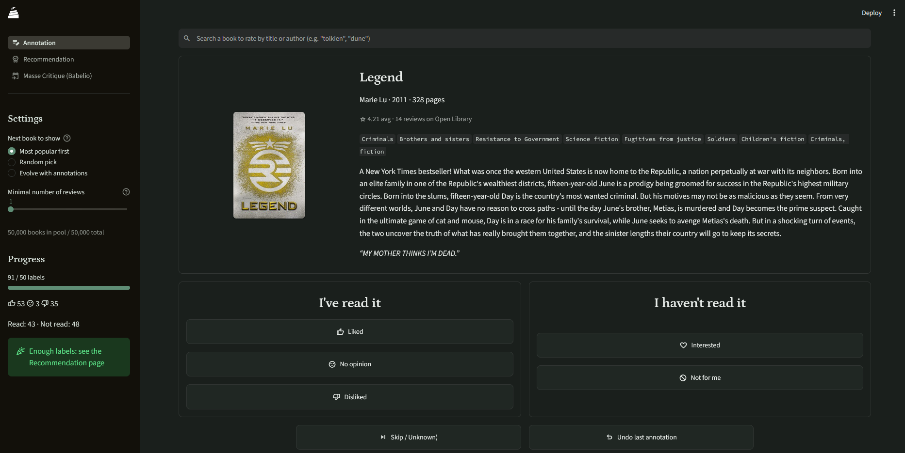

<p align="center"><a href="./README.md">English</a> | Français</p>


<h1 align="center">Babl</h1>

<p align="center">Babl est une application de bureau <a href="https://streamlit.io/">Streamlit</a> qui donne des recommendations personnalisées de livres</br>Et tout ça en local, sur votre ordinateur!</p>


<p align="center">
  <a href="https://github.com/loic-lhf/Babl/blob/main/LICENSE">
    
  </a>
  <a href="https://github.com/loic-lhf/Babl">
    
  </a>
</p>



## 👋 Contexte

Salut !

J'ai commencé ce projet car je voulais participer aux [opérations Masse Critique de Babelio](https://www.babelio.com/massecritique.php). Sauf que je n'avais pas la motivation de relire et juger chaque livre de chaque opération (+ de 200 chaque mois) pour trouver ceux qui pourraient potentiellement me plaire.

Cela m'a donné envie de créer un outil qui classerait, à ma place, ces livres suivant mes goûts, afin d'aller plus vite. **Babl** rempli exactement ce rôle, mais je me suis un peu emporté... Et c'est une véritable application de bureau maintenant!

## 🧙‍♂️ Fonctionnalités

- 🌗 Mode sombre et mode clair (c'est la base)
- 📚 Une base de données légère contenant 50 000 livres pré-traités
- 🏷️ Un outil d'annotation pour indiquer les livres que vous aimez ou pas, avec :
    - 🎭 Actions: lu/non lu - aimé/pas aimé - ignorer - annuler
    - 🔀 Différents modes de suggestion
    - 🔍 Fonctionnalité de recherche
    - 📝 Un formulaire pour ajouter des livres manquants
- 💡 Un outil de recommandation basé sur [Open Library](https://openlibrary.org/)
    - 🪶 Un modèle d'apprentissage automatique léger
    - 🏠 Fonctionne en local, et sans internet
    - 🔒 Vos données vous appartiennent (elles ne quittent pas votre ordinateur)
    - 📈 De nombreux graphiques et des explications pour comprendre les résultats
- 💡 Un outil de recommandation pour les [opérations Masse Critique de Babelio](https://www.babelio.com/massecritique.php)
    - 🎯 Récupération semi-automatique des livres de l'événement
    - ❤️ Recommandations personnalisées de livres susceptibles de vous plaire


## 🚀 Comment démarrer
### Pré-requis

Pour utiliser ce projet, vous devez tout d'abord installer les logiciels suivants sur votre ordinateur:

- `git`: voir [ce tutoriel (en anglais)](https://github.com/git-guides/install-git)
- `uv`: voir [cet autre tutoriel (en anglais)](https://docs.astral.sh/uv/getting-started/installation/)


### Installation

Ouvrez un terminal sur votre ordinateur (tapez "powershell" dans le menu Démarrer pour windows). Dans le terminal, copiez et executez les commandes suivantes pour copier ce projet sur votre ordinateur:

```bash
git clone https://github.com/loic-lhf/Babl.git
cd Babl
```
Ensuite, dans le même terminal, copiez et executez cette commande:

```bash
uv run streamlit run app.py
```

Votre navigateur devrait s'ouvrir directement sur la page de l'application, vous êtes prêt !

> [!WARNING]  
> Lors de votre premier lancement, l'application aura besoin de télécharger et installer un certain nombre de librairies logicielles. Ne fermez pas la fenêtre de téléchargement avant que celui-ci ne soit terminé !


### Conseils

Toutes vos données sont dans le sous-dossier `my_infos`, et ne quittent jamais votre ordinateur.

Si vous voulez editer/ajouter/retirer des informations, vous pouvez le faire dans ce sous-dossier. *Normalement* n'importe quel fichier/dossier à l'intérieur peut-être supprimé, ce qui remettra à zéro vos données concernant cet élément lors de votre prochaine session.

## 🛠️ Utilisation avancée

Si 50 000 livres ne vous suffit pas, alors rendez-vous à [openlibrary.org/developers/dumps](https://openlibrary.org/developers/dumps). Téléchargez les fichiers nommés "all types" et "ratings" dumps (attention : ils font plusieurs gigaoctets). Ensuite, vous pouvez décider quels livres utiliser pour votre jeu de données avec le script `prepare_data.py`.

Executez cette commande dans votre terminal pour plus de détails:
```bash
uv python prepare.py -h
```

## 🗺️ Feuille de route
Je liste ici les problèmes connus sur lesquels je travaille actuellement, ainsi que les fonctionnalités que j'aimerais ajouter (par ordre de priorité) :
- [ ] Amélioration des recommendations.
- [ ] Créer une interface pour éditer les annotations.
- [ ] Traduction en français
    - [X] README.md
    - [ ] Interface utilisateur
    - [ ] métadonnées des livres

## 📞 Contact

N'hésitez pas à me contacter en cas de problèmes ou pour me faire part de vos suggestions.

- 🐛 **Bugs & problèmes :** Utilisez [GitHub Issues](https://github.com/loic-lhf/Babl/issues)

Pour tout autre demande, n'hésitez pas à me contacter via [Bluesky](https://bsky.app/profile/loic-lhf.bsky.social)!


## ⚠️ Disclaimer

Une grande partie de ce code a été écrite à l'aide de [claude.ai](https://claude.ai), le LLM d'[Anthropic](https://www.anthropic.com/) (la version gratuite par contre, parce que j'ai pas d'argent a jeter par les fenêtres). J'ai systématiquement passé en revue tout le code généré par [claude.ai](https://claude.ai), je l'ai compris et l'ai modifié lorsque cela s'avérait nécessaire. Je pense que c'est une bonne pratique de travailler de cette manière, et de communiquer sur cet usage car **les LLM ne sont que des sources d'informations auxquelles on ne peut pas se fier aveuglément.**

*Je ne peux que recommander à tout le monde de faire de même.*